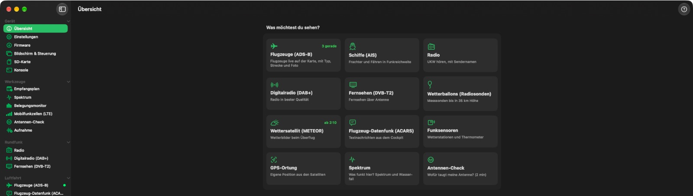
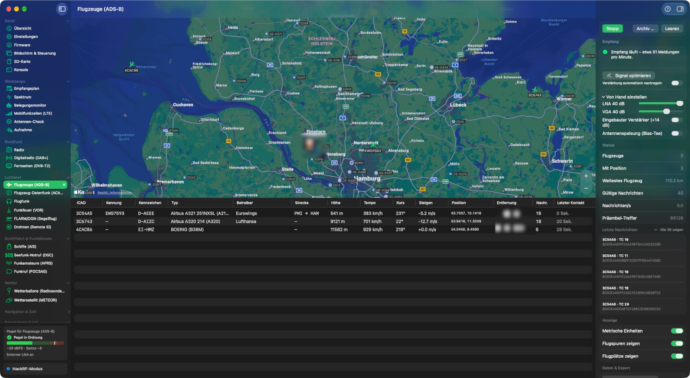
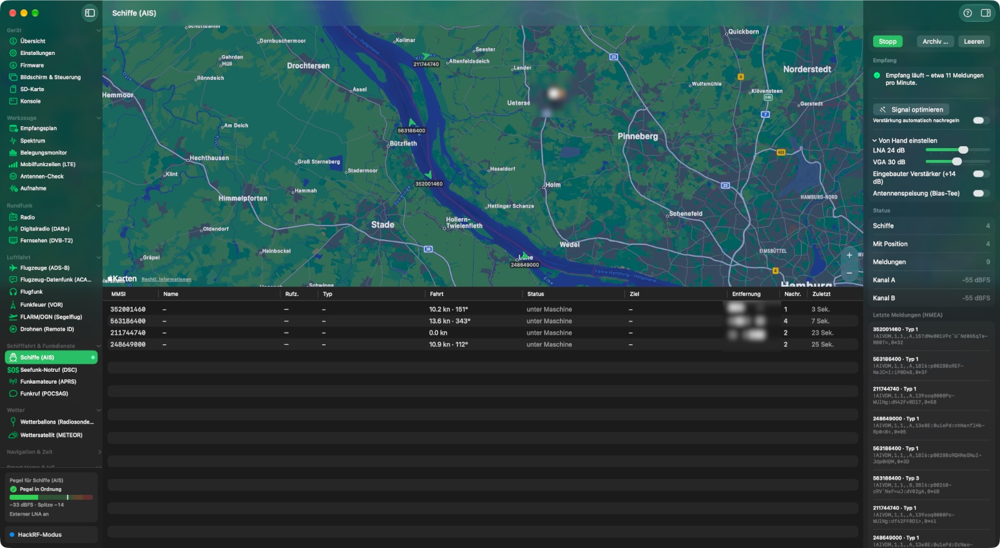
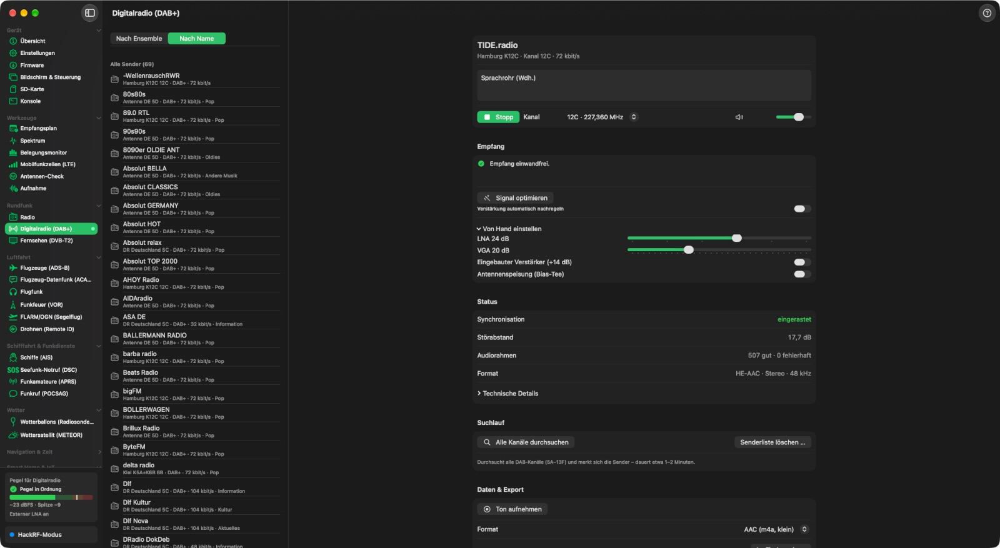
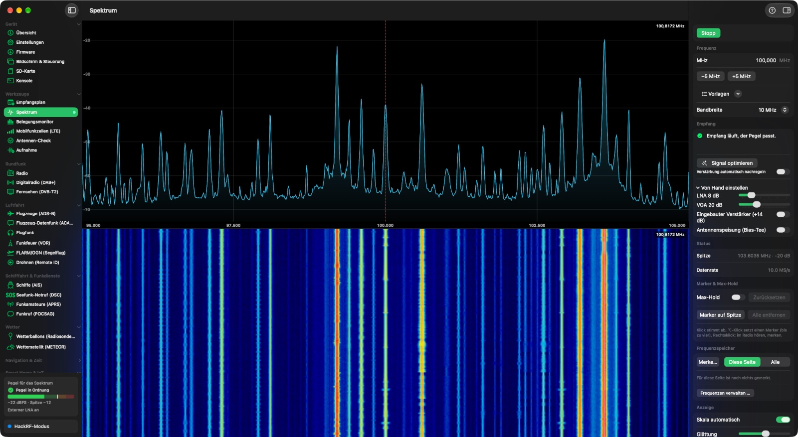
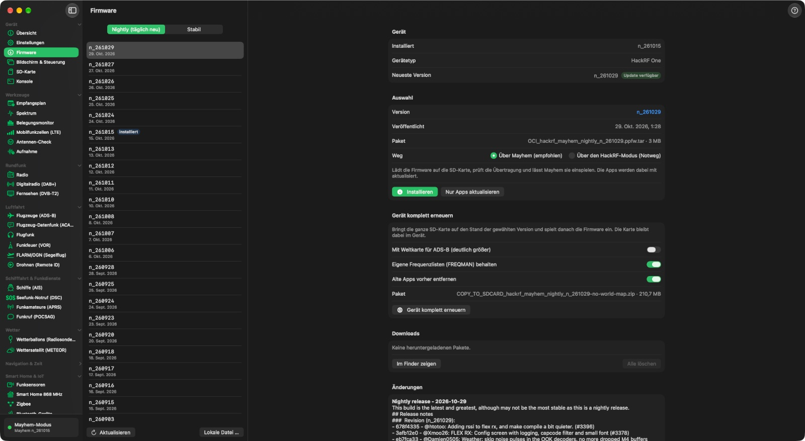

# PortaPack Manager

[Deutsch](README.de.md) · **English**

**A receiving lab for the HackRF One with PortaPack – as a macOS app.**

Aircraft and ships on the map, FM, digital radio and TV, weather balloons and
satellite images, wireless sensors and smart home radio – PortaPack Manager
decodes everything itself, without extra software. Along the way it keeps the
PortaPack's Mayhem firmware up to date.

Made for beginners: plug in, click a tile on the start page, done. The app sets
gain, frequencies and channels by itself – you can still adjust everything by
hand.

➜ **[Manual](Docs/Help-en.md)** (the same as *Help* in the app)



The screenshots show the German interface; the app follows the system language
(German or English) and can be switched under Settings ▸ General.

## What the app does

**Receiving** (HackRF mode – the app switches into it by itself)

| Area | Receivers |
|---|---|
| Tools | Reception schedule (satellites and weather balloons automatically) · Spectrum and waterfall with markers and max hold · Occupancy monitor over hours/days · LTE cell search · Antenna check · IQ recording and playback, SigMF export/import |
| Broadcast | FM with RDS and stereo, AM/NFM, SSB/CW with selectable filters · DAB+ · DVB-T2 (terrestrial TV) · Audio recording |
| Aviation | ADS-B with map, type, route, photo and airports · ACARS/VDL2 with plain-language interpretation and CPDLC · Airband scanner with transcription (on the Mac) and search · VOR beacons with cross bearing · FLARM · Drone ID (Remote ID) |
| Maritime & radio services | AIS with map and photo · Maritime distress (DSC) · APRS · Paging (DAPNET) |
| Weather | Radiosondes (weather balloons) · Weather satellite METEOR-M |
| Navigation & time | GPS positioning · DCF77 radio clock |
| Smart home & IoT | Wireless sensors (433/868 MHz) · Z-Wave, Homematic, EnOcean, wireless meters (868 MHz) · Zigbee with decryption · Thread · Bluetooth LE · Wi-Fi · LoRaWAN · Meshtastic |
| Amateur radio & space | ISS (SSTV, APRS) and amateur satellites · FT8/WSPR · Hydrogen line (radio astronomy) |

**Made for beginners**

- Start page with tiles: one click opens, switches and starts.
- Every receiver page has the same layout, with a status line in plain language
  (“Receiving – about 12 messages per minute”).
- *Optimize Signal* and automatic gain control against overload.
- Antenna check: measures all bands and tells you what your antenna is good for.
- Initial setup with automatic crystal calibration; all settings in one place.
- Frequency memory for all pages, CSV import and export (including lists from
  SDR++/CHIRP); save live lists as CSV.
- Keeps running in the background, with a menu bar icon and, if you like, start
  at login.
- Interface and manual in German and English; built-in manual with one chapter
  per page.

**On the go and connected**

- Remote access from your phone – see below.
- Notifications on the Mac or via [ntfy](https://ntfy.sh) on your phone.
- Archive of all sightings (aircraft, ships, weather balloons, airband) in a
  database, with retention period and ZIP backup.
- Share data (all opt-in): ADS-B to adsb.fi/airplanes.live, AIS as NMEA,
  radiosondes to SondeHub, readings to Home Assistant (MQTT).

**Device management** (Mayhem mode)

- Firmware update (nightly/stable) with package and checksum verification,
  “Renew Device Completely” including the SD card contents.
- **Remote control of the PortaPack:** its display appears live on the Mac;
  clicks act as touches, arrow keys and Enter work like the buttons on the
  device, and you type text directly. Screenshots at the push of a button.
- Edit the SD card (with checksums, or as a drive for large amounts), console.

## Remote access from your phone

The Mac becomes a receiver you can use from the sofa or on the road: a web page
for phone and tablet – nothing to install, on the iPhone simply “Add to Home
Screen”.

- **14 receivers** in one menu: aircraft and ships on the map, airband,
  aircraft datalink, maritime distress, weather & satellites (balloons with
  landing estimate and flight profile), DAB+ and radio, spectrum, occupancy
  monitor, wireless sensors, smart home 868, Zigbee with network map, FT8/WSPR.
- **Audio on the phone** for radio, DAB+ and airband; tuning and band scan from
  the phone.
- **Start, stop, Optimize Signal** – the phone switches the HackRF itself.
  Frequency memory, airband channel list and reception schedule are shared with
  the Mac; schedule entries can be skipped from the phone.
- **Secure by default:** an access key in the address (set up via QR code),
  only devices from your home network or VPN (e.g. Tailscale) are accepted,
  keys for Zigbee or meters never leave the Mac.
- German and English, light and dark.











## Requirements

- macOS 15 or later (Apple silicon or Intel)
- HackRF One with PortaPack and [Mayhem firmware](https://github.com/portapack-mayhem/mayhem-firmware)
  (from about v2.0 or nightly 2024)
- An antenna – the better and higher, the more you receive. For weather
  satellites a dedicated satellite antenna (V-dipole/QFH), for GPS an active GPS
  antenna.

## Installation

**Ready-made app:** download the disk image `PortaPackManager-<version>.dmg`
from *Releases*, open it and drag the app to *Applications*. It is signed with
Developer ID and notarized by Apple – macOS starts it without a warning.

**From source** (Xcode 26 and [XcodeGen](https://github.com/yonaskolb/XcodeGen)):

```bash
brew install xcodegen
Scripts/run.sh            # build, install to ~/Applications, launch
```

For a signed app, create `Config/Signing.local.xcconfig` from the template;
without it the project builds unsigned. If a Developer ID certificate is in the
keychain, `run.sh` signs with it.

## Privacy and legal

- The app **only receives**; it does not transmit over the air.
- Your location stays on the Mac unless you explicitly share it. What the app
  sends to the internet (firmware, aircraft and ship photos, satellite orbits …)
  is listed in the [manual](Docs/Help-en.md#recht).
- Messages not intended for you – such as alerts for fire brigades, ambulance
  services and police – may neither be evaluated nor passed on (in Germany
  § 5 TDDDG; other countries have similar rules). That's why the pager receiver
  only offers DAPNET.

## Development

```bash
xcodegen generate
xcodebuild -project PortaPackManager.xcodeproj -scheme PortaPackManager -destination 'platform=macOS' build
xcodebuild test -project PortaPackManager.xcodeproj -scheme PortaPackManager -destination 'platform=macOS'
```

- SwiftUI, Swift 6, no third-party libraries. USB via IOKit
  (`PortaPackManager/HackRF/HackRFUSB.c`), serial via POSIX.
- More than 900 tests (Swift Testing): decoders with reference vectors and test
  signals, a fuzz test for all radio parsers, a simulation test bench for
  DVB-T2.
- Code comments are in German.
- New receiver pages get a chapter in [`Docs/Hilfe.md`](Docs/Hilfe.md) and
  [`Docs/Help-en.md`](Docs/Help-en.md) (a test checks the German manual).

### Release

```bash
Scripts/release.sh --dry-run   # tests, build, Developer ID signature, DMG – without Apple
Scripts/release.sh             # plus notarization and stapling; uploads nothing
```

Requires a “Developer ID Application” certificate and a notarytool profile in
the keychain (name in `NOTARY_PROFILE`, default `portapack-notarisierung`).

## License

[GNU General Public License v3.0](LICENSE) or later. See [CHANGELOG.md](CHANGELOG.md)
for what changed in each version.

PortaPack Manager is an independent project and is not affiliated with or
endorsed by ShareBrained Technology (PortaPack), Great Scott Gadgets (HackRF)
or the Mayhem firmware team. The names are used only to describe compatibility.

Several decoders are based on free GPL projects or use their tables – among
them gr-dtv (DVB-T2 LDPC), dumpvdl2/libacars (VDL2, CPDLC schemas), rtl_433
(wireless sensors), readsb/dump1090 (ADS-B), SatDump (METEOR), gr-lora (LoRa)
and WSJT-X via ft8_lib (MIT) and wsprd (FT8/WSPR: LDPC tables, Fano metric).
[Leaflet](https://leafletjs.com) 1.9.4 (BSD-2-Clause, © Vladimir Agafonkin,
CloudMade) is bundled for the maps in remote access.
